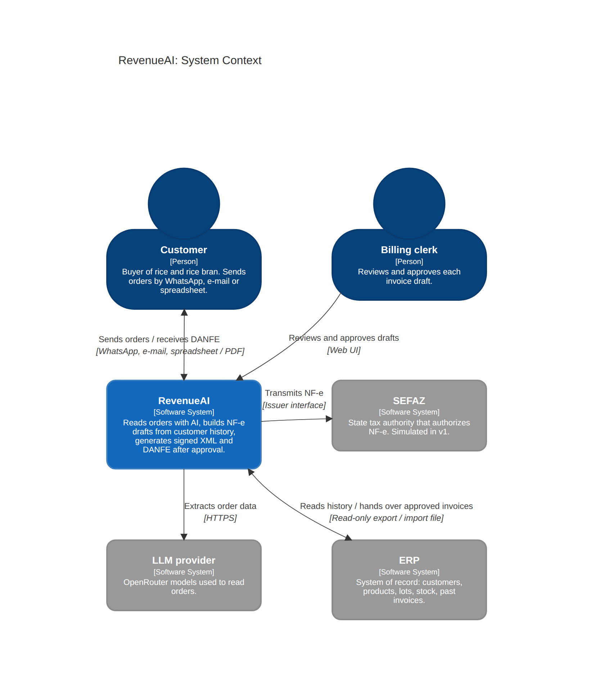

# RevenueAI

An AI agent that turns customer orders (WhatsApp, e-mail, spreadsheet) into ready-to-approve NF-e invoices for a rice mill, so nobody has to retype anything into the ERP.

## The problem

At a mid-sized rice mill, every sale of **rice** or **rice bran** needs an NF-e (Brazilian electronic invoice). Today a billing clerk builds each one by hand.

**Where orders come from**

| Channel | What arrives |
|---|---|
| WhatsApp | Free-text messages, sometimes a photo or a voice note |
| E-mail | Free text or an attached order |
| Spreadsheet | A list of orders, one per row, with each customer using a different layout |

**How it is done today**

1. Read the order and work out who the customer is, which product, how much, and at what price.
2. Open the ERP and fill in the invoice field by field: customer, product, **lot**, quantity, price, **carrier**, CFOP, **ICMS**, payment terms.
3. Check that the chosen lot has enough balance.
4. Check that the price is current.
5. Issue the NF-e and send the DANFE to the customer.

Most of these fields are the **same as the last invoice for that customer and product**, yet they are typed again every time.

**In numbers (approximate)**

| Metric | Today |
|---|---|
| Invoices per day | 10–30 (≈ 20 on average) |
| Time per invoice | 5–10 min (≈ 7 on average) |
| Time spent per day | ≈ 2 h 20 min of a person's day |
| Time spent per month (22 working days) | ≈ 50 hours |

**The 3 most common errors**

1. **Wrong customer**: a customer with a similar name or a different branch (CNPJ) gets picked.
2. **Lot without balance**: the invoice uses a lot that no longer has enough stock, so the lot has to be fixed after the fact.
3. **Outdated price**: an old price is used after the price list has changed.

Each of these errors means an NF-e has to be cancelled or corrected, which costs time and annoys the customer.

## What this project does

1. An order arrives (pasted text in v1; WhatsApp, e-mail and spreadsheet later), and the AI agent reads it.
2. The agent identifies the customer and product and checks the price and the lot balance.
3. It fills the remaining fields (lot, carrier, CFOP, ICMS…) **from the previous invoices for the same customer and product**.
4. It creates a **draft** invoice. A person reviews it on screen and approves it, and the lot balance is reduced only on approval.
5. The system generates the signed **NF-e XML, validated against the official XSD**, plus the **DANFE** PDF.

## Context diagram



Source: [docs/c4-context.mmd](docs/c4-context.mmd)

## Key decisions (ADRs)

| # | Decision |
|---|---|
| [001](docs/adr/001-do-not-write-to-erp.md) | Never write to the ERP database; produce an import file instead |
| [002](docs/adr/002-simulated-issuer.md) | SEFAZ transmission sits behind an `Issuer` interface and is simulated for now |
| [003](docs/adr/003-human-approval.md) | The AI never issues an invoice by itself; a person approves every one |
| [004](docs/adr/004-defaults-from-history.md) | Missing fields are filled from the history of the same customer and product |

## Stack

| Area | Choice |
|---|---|
| Language | TypeScript everywhere, Node.js 22 |
| API | NestJS 12 (ESM) + Swagger |
| Database | PostgreSQL 17 + Prisma 7 |
| Validation | Zod 4 (same schema validates requests and AI output) |
| AI | Vercel AI SDK 7 + OpenRouter |
| NF-e | node-sped-nfe, xmllint-wasm (XSD validation), @alexssmusica/node-pdf-nfe (DANFE) |
| Front end | Next.js 16 + Tailwind |
| Tests | Vitest + Supertest against a real Postgres |
| WhatsApp | WhatsApp Cloud API (Meta test number) |
| AI observability | Langfuse Cloud |
| Queue (v3) | RabbitMQ on CloudAMQP |
| Local infra / CI | Docker Compose, GitHub Actions |
| Deploy | Vercel (UI), Railway (API), Neon (Postgres) |

## Repository layout

```
docs/          architecture docs, C4 diagram, ADRs
apps/          api (NestJS) and web (Next.js), added in later steps
agents/        agent prompts and specs
features/      feature specs
tools/         scripts for tasks we repeat (tests, front-end checks, diagram rendering…)
roadmap.md     versions and steps
```

## Status

Version 1 in progress. See [roadmap.md](roadmap.md).
